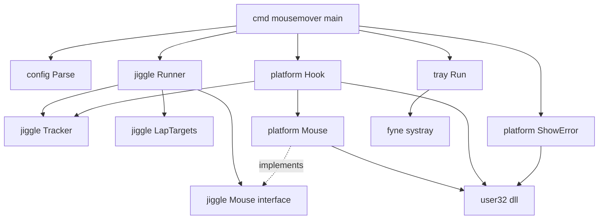
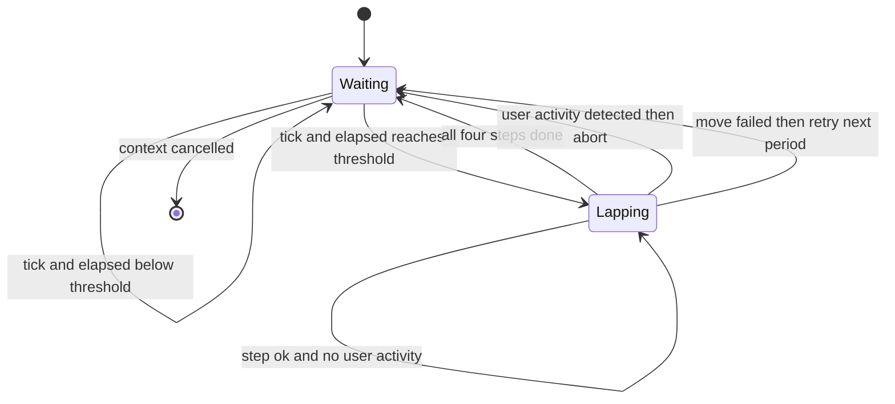
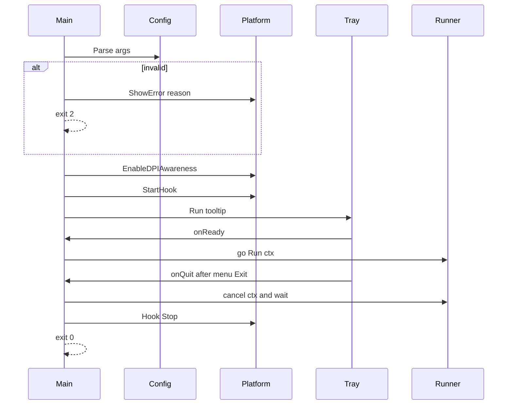

# Design Document: idle-mouse-mover

## Overview
**Purpose**: マウスを最後に操作してから一定時間たったときだけ、カーソルを小さく 1 周させる。これにより、業務アプリのタイムアウトとチャットツールの「離席中」表示を防ぐ。
**Users**: OS の設定を変えられない業務 PC で作業する開発者本人。exe をダブルクリックして起動し、タスクトレイに常駐させて使う。
**Impact**: 新規開発。既存のコードはない。

### Goals
- マウス操作だけを「ユーザーの操作」と見なしてアイドル時間を測り、アイドル時間が設定値に達するたびにカーソルを上 → 右 → 下 → 左に 1 周させる
- ユーザーが操作している間、または 1 周の途中で操作したときは、介入しない
- ランタイム不要の単一 exe とし、一般ユーザー権限で Windows 10 / 11 のタスクトレイに常駐させる
- 判定ロジックを OS から切り離し、時間に関する振る舞いをすべてユニットテストで検証できるようにする

### Non-Goals
- キーボード入力の検知、一時停止、ログオン時の自動起動、多重起動の防止、設定の保存・設定画面（requirements の Out of scope のとおり）
- 管理者権限で動くウィンドウが前面にある間に移動を効かせること（UIPI の制約）
- ログファイルや動作履歴の記録

## Boundary Commitments

### This Spec Owns
- マウス操作の検知（フックとポーリング）と、自分が送った入力を見分ける規則
- アイドル判定の条件式（基準時刻 = max(最後のユーザー操作, 最後の 1 周の終了)）
- 1 周分の目標座標の計算（画面の端で範囲内に収める処理を含む）と、移動の実行・途中で取りやめる処理
- 起動オプション `-idle` / `-step` の形式、検証、既定値
- タスクトレイのアイコン、ツールチップ、「終了」メニュー
- ビルド方法（`CGO_ENABLED=0`、`-H=windowsgui`）と exe の配布形態

### Out of Boundary
- 業務アプリやチャットツールが、カーソル移動を「操作あり」と判定するかどうか（相手側の挙動）
- OS の画面ロック・スリープの設定と、ロック中の挙動
- キーボード入力、そのほかの入力デバイス（ペン、タッチ）の検知
- インストーラー、コード署名、自動更新

### Allowed Dependencies
- Go 標準ライブラリ
- `golang.org/x/sys/windows`: Win32 API の呼び出し。`internal/platform` だけで使う
- `fyne.io/systray` v1.12.x: タスクトレイ。`internal/tray` だけで使う
- 依存の向き: `cmd/mousemover` → `internal/{config, jiggle, tray, platform}`、`internal/platform` → `internal/jiggle`（型だけ）。`internal/jiggle` と `internal/config` は、OS 依存のパッケージと外部ライブラリを import しない

### Revalidation Triggers
- `jiggle.Mouse` / `jiggle.Clock` インターフェースの形を変える場合（テスト用の偽物と platform の実装の両方に影響する）
- 「自分が送った入力」の見分け方を変える場合（要件 1.4、2.4 の再検証が要る）
- 起動オプションの名前・形式を変える場合（ショートカットに書いた引数が使えなくなる）
- `fyne.io/systray` のメジャー更新、または cgo が必要な依存の追加（単一の静的 exe という前提が崩れる）

## Architecture

### Architecture Pattern & Boundary Map



**Architecture Integration**:
- Selected pattern: Ports & Adapters。ドメイン（`jiggle`）が `Mouse` / `Clock` インターフェースを宣言し、`platform` がそれを実装する。こうすることで、時間に関する要件を偽の時計で検証できる
- Domain boundaries: アイドル判定と移動の手順は `jiggle` が持つ。Win32 の細部（座標の正規化、フック、DPI）は `platform` が持つ。UI（タスクトレイ）は `tray` が持つ
- Steering compliance: structure.md の `cmd → domain ← platform` に従う。インターフェースは使う側（`jiggle`）で定義する。副作用（実時間・実カーソル）は main で注入する
- Steering deviation: tech.md の「最初はコンソールアプリにする」「依存は x/sys だけ」「ポーリングだけで検知」は、要件 3（タスクトレイ）と要件 1.1（クリック・ホイールの検知）に合わせて変更する。steering も同時に更新する

### Technology Stack

| Layer | Choice / Version | Role in Feature | Notes |
|-------|------------------|-----------------|-------|
| Runtime | Go 1.22 以上（開発環境は 1.27.4） | 単一の静的 exe をビルドする | `CGO_ENABLED=0`, `-ldflags "-s -w -H=windowsgui"` |
| OS 連携 | golang.org/x/sys/windows（最新） | `SendInput`, `GetCursorPos`, `SetCursorPos`, `SetWindowsHookExW`, `GetSystemMetrics`, `SetProcessDpiAwarenessContext`, `MessageBoxW` | `windows.NewLazySystemDLL("user32.dll")` で読み込む |
| UI | fyne.io/systray v1.12.2 | タスクトレイのアイコン、ツールチップ、メニュー | Windows では cgo なしでビルドできることを確認済み（research.md） |
| Assets | `.ico`（`go:embed`） | トレイのアイコン | Windows の systray は `.ico` 形式しか受け付けない |

## File Structure Plan

### Directory Structure
```
c:/dev/dev1/
├── go.mod                          # module mousemover。x/sys と fyne.io/systray に依存する
├── go.sum
├── .gitignore                      # dist/ を除外する
├── README.md                       # 使い方（起動オプション、ビルドコマンド、終了方法）
├── cmd/
│   └── mousemover/
│       └── main.go                 # 依存の組み立て、起動と終了の順序、終了コード
├── internal/
│   ├── config/
│   │   ├── config.go               # Config 型、Parse、既定値、検証、ツールチップの文言
│   │   └── config_test.go
│   ├── jiggle/
│   │   ├── types.go                # Point, Rect, Mouse, Clock インターフェース、Settings
│   │   ├── tracker.go              # Tracker: 最後のユーザー操作の時刻（atomic）
│   │   ├── lap.go                  # LapTargets: 1 周分の目標座標の計算と、範囲内に収める処理
│   │   ├── runner.go               # Runner: ポーリング、アイドル判定、1 周の実行と途中での取りやめ
│   │   ├── clock.go                # SystemClock: time.Now と time.After の実装
│   │   ├── tracker_test.go
│   │   ├── lap_test.go
│   │   └── runner_test.go          # 偽の Clock と偽の Mouse で、時間に関する要件をすべて検証する
│   ├── platform/
│   │   ├── user32_windows.go       # user32 の関数ポインターと、Win32 構造体・定数の定義
│   │   ├── mouse_windows.go        # Mouse: jiggle.Mouse の実装と、自分の入力の見分け（IsOwnInput）
│   │   ├── hook_windows.go         # Hook: WH_MOUSE_LL 専用スレッド、メッセージループ、停止
│   │   ├── dpi_windows.go          # EnableDPIAwareness
│   │   └── dialog_windows.go       # ShowError（MessageBoxW）
│   └── tray/
│       ├── tray.go                 # Run / Quit。アイコン、ツールチップ、「終了」メニュー
│       └── icon.ico                # 16x16 と 32x32 を含むアイコン（go:embed）
└── dist/                           # ビルド成果物 mousemover.exe（git の管理対象外）
```

### Modified Files
- `README.md` — 現在は空。使い方とビルド方法を書く
- `.kiro/steering/tech.md` — タスクトレイ常駐、依存が 2 つになること、フックを主とする検知に合わせて更新する（この設計と同時に反映する）

## System Flows

### 1 周の判定と実行



- **tick**: `PollInterval`（1 秒）ごと。`elapsed = now − max(Tracker.LastActivity(), lastLapEnd)`
- **途中で取りやめる条件**（2.4）: 各ステップの前に、次のどちらかに当てはまれば取りやめる。(a) `Tracker.LastActivity()` が 1 周の開始時刻より後になっている、(b) `CursorPos()` が直前の目標座標と違う。取りやめたら `lastSeen` を現在位置に更新し、カーソルは動かさない
- **移動の失敗**（2.5）: `MoveTo` がエラーを返したら 1 周を打ち切る。それでも `lastLapEnd = now` にするので、次の周期に再び試す
- 1 周が終わるか打ち切られたら、`lastLapEnd = now`、`lastSeen = CursorPos()` にする。こうすると、自分が動かした結果の位置を次の tick で「位置の変化」と見なさない（1.4）

### 起動と終了



- `EnableDPIAwareness` が失敗しても続行する（すでに設定済みの場合などがあるため）。`StartHook` が失敗したときは `ShowError` を表示して終了コード 1 で終わる（フックがないと要件 1.1 を満たせないので、早めに失敗させる）

## Requirements Traceability

| Requirement | Summary | Components | Interfaces | Flows |
|-------------|---------|------------|------------|-------|
| 1.1 | マウス操作（移動・クリック・ホイール）からアイドル時間を測る | Hook, Tracker, Runner | `Hook` → `Tracker.MarkActivity` | 1 周の判定 |
| 1.2 | 操作したら計測を最初に戻す | Tracker, Runner | `Tracker.MarkActivity`, `LastActivity` | 1 周の判定 |
| 1.3 | 設定値に達するまで動かさない | Runner | `Runner.Run` の判定式 | 1 周の判定 |
| 1.4 | 自分の移動は操作と見なさない | Mouse, Hook, Runner | `Mouse.IsOwnInput`, `lastSeen` の更新 | 1 周の判定 |
| 1.5 | キーボードは数えない | Hook | 登録するのは WH_MOUSE_LL だけ | — |
| 2.1 | 上 → 右 → 下 → 左に設定量ずつ 1 周させる | Lap, Runner, Mouse | `LapTargets`, `Mouse.MoveTo` | 1 周の判定 |
| 2.2 | 1 周後は開始位置に戻る | Lap, Mouse | `LapTargets` の 4 番目 = 開始位置。`MoveTo` の事後条件 | 1 周の判定 |
| 2.3 | 前回の 1 周から設定値ごとに繰り返す | Runner | `lastLapEnd` を基準時刻に含める | 1 周の判定 |
| 2.4 | 途中で操作したら取りやめる | Runner, Tracker | 途中で取りやめる条件 (a)(b) | 1 周の判定 |
| 2.5 | 移動に失敗しても続行し、次の周期で再び試す | Runner, Mouse | `MoveTo` の error | 1 周の判定 |
| 3.1 | トレイにアイコンを出し、ウィンドウは出さない | Tray, main | `tray.Run`、`-H=windowsgui` | 起動と終了 |
| 3.2 | 右クリックで「終了」を含むメニュー | Tray | `systray.AddMenuItem` | 起動と終了 |
| 3.3 | 「終了」で止めてアイコンを消し、終了する | Tray, main, Runner, Hook | `OnQuit`、ctx の cancel、`Hook.Stop` | 起動と終了 |
| 3.4 | ツールチップに動作中であることと設定値を出す | Tray, Config | `Config.Summary` | 起動と終了 |
| 4.1 | アイドル時間を指定できる | Config | `-idle` | 起動と終了 |
| 4.2 | 移動量を指定できる | Config | `-step` | 起動と終了 |
| 4.3 | 指定がなければ 5 分 / 10px | Config | `DefaultIdleThreshold`, `DefaultStepPixels` | — |
| 4.4 | 値がおかしければ理由を表示して終了する | Config, Dialog, main | `Parse` の error、`ShowError`、exit 2 | 起動と終了 |
| 5.1 | ランタイム不要の単体 exe | ビルド設定 | `CGO_ENABLED=0` | — |
| 5.2 | 一般ユーザー権限で動く | Hook, Mouse | 管理者権限を要する API を使わない。manifest で昇格を求めない | — |
| 5.3 | Windows 10 / 11 で動く | platform | 使う API はどれも Windows 10 1703 以降にある | — |

## Components and Interfaces

| Component | Domain/Layer | Intent | Req Coverage | Key Dependencies (P0/P1) | Contracts |
|-----------|--------------|--------|--------------|--------------------------|-----------|
| Config | config | 起動オプションを解釈・検証し、既定値を当てはめる | 3.4, 4.1–4.4 | flag（P0） | Service |
| Tracker | jiggle | 最後のユーザー操作の時刻を、スレッドセーフに保持する | 1.1, 1.2, 2.4 | — | State |
| LapTargets | jiggle | 1 周分の 4 つの目標座標を計算する | 2.1, 2.2 | — | Service |
| Runner | jiggle | アイドル判定、1 周の実行、途中での取りやめ、再試行 | 1.1–1.4, 2.1–2.5 | Mouse（P0）, Clock（P0）, Tracker（P0） | Service, State |
| SystemClock | jiggle | 実時間の Clock | 1.1, 2.3 | time（P0） | Service |
| Mouse | platform | Win32 でカーソル位置を読み、移動し、自分の入力を見分ける | 1.4, 2.1, 2.2, 2.5, 5.2 | user32（P0） | Service |
| Hook | platform | 低レベルマウスフックで、ユーザーの操作を通知する | 1.1, 1.4, 1.5, 3.3 | user32（P0）, Mouse（P0） | Service |
| EnableDPIAwareness / ShowError | platform | DPI 設定と、エラーダイアログ | 2.2, 4.4 | user32（P1） | Service |
| Tray | tray | トレイのアイコン、ツールチップ、終了メニュー | 3.1–3.4 | fyne.io/systray（P0） | Service |
| main | cmd | 依存の組み立て、起動と終了の順序、終了コード | 3.1, 3.3, 4.4, 5.1 | 上のすべて | — |

### config

#### Config

| Field | Detail |
|-------|--------|
| Intent | 起動オプションを、検証済みの設定値にする |
| Requirements | 3.4, 4.1, 4.2, 4.3, 4.4 |

**Responsibilities & Constraints**
- `flag.NewFlagSet("mousemover", flag.ContinueOnError)` で解釈する。出力先は `io.Discard` にする（コンソールがないため）
- `-idle` は `time.Duration`（例: `5m`, `90s`, `1h`）。既定値は 5 分
- `-step` は `int`（px）。既定値は 10
- オプション以外の引数が残っていたら、エラーにする

**Contracts**: Service [x]

##### Service Interface
```go
package config

const (
    DefaultIdleThreshold = 5 * time.Minute
    DefaultStepPixels    = 10
)

type Config struct {
    IdleThreshold time.Duration // > 0
    StepPixels    int           // > 0
}

// Parse は os.Args[1:] を受け取る。
// 失敗したときは、そのまま利用者に見せられる日本語のメッセージを持つ error を返す。
func Parse(args []string) (Config, error)

// Summary はツールチップ用の文言を返す。例: "Idle Mouse Mover: 動作中\nアイドル 5分 / 移動 10px"
func (c Config) Summary() string
```
- Preconditions: なし
- Postconditions: error が nil なら `IdleThreshold > 0` かつ `StepPixels > 0`
- エラーの例: `-idle の値 "abc" を時間として解釈できません（例: 5m, 90s）`、`-step は 1 以上の整数で指定してください（指定値: 0）`、`不明なオプションです: -foo`

### jiggle（ドメイン）

#### 共通の型（types.go）

```go
package jiggle

type Point struct{ X, Y int }

// Rect は仮想スクリーンの範囲。Left/Top を含み、Right/Bottom は含まない。
type Rect struct{ Left, Top, Right, Bottom int }

type Mouse interface {
    CursorPos() (Point, error)
    // MoveTo はユーザーの入力と同じ扱いになる方法で p へ移動する。
    // 事後条件: 成功したら CursorPos() == p。
    MoveTo(p Point) error
    Bounds() (Rect, error)
}

type Clock interface {
    Now() time.Time
    After(d time.Duration) <-chan time.Time
}

type Settings struct {
    IdleThreshold time.Duration // config から受け取る
    StepPixels    int           // config から受け取る
    PollInterval  time.Duration // 固定値 1s
    StepDelay     time.Duration // 固定値 50ms（各ステップの移動をアプリに確実に届けるための間隔）
}
```

#### Tracker

| Field | Detail |
|-------|--------|
| Intent | 最後のユーザー操作の時刻を、フックのスレッドと Runner の間で共有する |
| Requirements | 1.1, 1.2, 2.4 |

**Contracts**: State [x]

```go
type Tracker struct{ /* atomic.Int64（UnixNano） */ }

func NewTracker(now time.Time) *Tracker // 起動した時刻を「最後の操作」として初期化する
func (t *Tracker) MarkActivity(at time.Time) // 単調。今より古い時刻を渡されたら無視する
func (t *Tracker) LastActivity() time.Time
```
- Invariants: `LastActivity()` は戻らない。ロックを取らない（フックのコールバックから呼ぶため）

#### LapTargets

| Field | Detail |
|-------|--------|
| Intent | 開始位置から、上 → 右 → 下 → 左の 4 つの目標座標を出す |
| Requirements | 2.1, 2.2 |

```go
// 戻り値: [上, 右上, 右, 開始位置]。各座標は bounds に収めた値。
// 4 番目は必ず start（start が bounds の外にある場合は、収めた start）。
func LapTargets(start Point, step int, bounds Rect) [4]Point
```
- 例: start=(100,100), step=10 → (100,90), (110,90), (110,100), (100,100)
- 画面の端: start=(100,0) → (100,0), (110,0), (110,0), (100,0)。上へは動かせないが、横へは動く

#### Runner

| Field | Detail |
|-------|--------|
| Intent | アイドル判定のループを回し、1 周を実行する |
| Requirements | 1.1, 1.2, 1.3, 1.4, 2.1, 2.2, 2.3, 2.4, 2.5 |

**Dependencies**
- Outbound: Mouse — 位置の取得と移動（P0）。Clock — 時刻と待ち時間（P0）。Tracker — 最後の操作の時刻（P0）

**Contracts**: Service [x] / State [x]

```go
func NewRunner(s Settings, m Mouse, c Clock, t *Tracker) *Runner

// Run は ctx が cancel されるまで処理を続け、ctx.Err() を返す。
// Mouse の error では終了しない（2.5）。
func (r *Runner) Run(ctx context.Context) error
```

##### State Management
- 内部状態: `lastSeen Point`（最後に確認した位置）、`lastLapEnd time.Time`（ゼロ値なら判定に使わない）
- tick ごとの処理:
  1. `CursorPos()` が `lastSeen` と違えば `Tracker.MarkActivity(now)` を呼ぶ（フックの取りこぼしを補う）
  2. `now − max(LastActivity, lastLapEnd) ≥ IdleThreshold` なら 1 周を実行する
- 並行性: `Runner` は 1 つの goroutine で動く。外部と共有するのは `Tracker` だけ

**Implementation Notes**
- Validation: 時間に関する要件はすべて、偽の Clock（手動で進める）と偽の Mouse（座標と呼び出し履歴を記録し、エラーを注入できる）で検証する
- Risks: `CursorPos` が失敗した tick は判定を飛ばす（ロック中などに起きる）

#### SystemClock
- `time.Now()` と `time.After()` をそのまま呼ぶ、要約だけのコンポーネント（2.3 などの実時間の動作を担う）

### platform（Windows アダプター）

#### Mouse

| Field | Detail |
|-------|--------|
| Intent | `jiggle.Mouse` を Win32 で実装し、自分の入力を見分ける規則を持つ |
| Requirements | 1.4, 2.1, 2.2, 2.5, 5.2 |

**Contracts**: Service [x]

```go
package platform

const injectSignature uintptr = 0x4D4F5645 // "MOVE"

type Mouse struct{ /* lastCommanded atomic: 最後に指示した座標 */ }

func NewMouse() *Mouse
func (m *Mouse) CursorPos() (jiggle.Point, error)  // GetCursorPos
func (m *Mouse) Bounds() (jiggle.Rect, error)      // GetSystemMetrics(SM_X/YVIRTUALSCREEN, SM_CX/CYVIRTUALSCREEN)
func (m *Mouse) MoveTo(p jiggle.Point) error

// IsOwnInput はフックから呼ばれる。次のどちらかなら true を返す。
// (1) extraInfo == injectSignature
// (2) injected かつ pt == 最後に指示した座標（SetCursorPos による補正の分）
func (m *Mouse) IsOwnInput(extraInfo uintptr, injected bool, pt jiggle.Point) bool
```
- `MoveTo` の手順: `lastCommanded = p` → `SendInput`（`MOUSEEVENTF_MOVE|ABSOLUTE|VIRTUALDESK`、`dwExtraInfo = injectSignature`、座標は仮想スクリーンを基準に 0–65535 に正規化）→ `GetCursorPos` が p と違えば `SetCursorPos(p)` で補正する
- 戻り値: `SendInput` が 0 を返したとき、または補正後も位置が違うときは error を返す

#### Hook

| Field | Detail |
|-------|--------|
| Intent | 低レベルマウスフックで、自分以外のマウスイベントを通知する |
| Requirements | 1.1, 1.4, 1.5, 3.3 |

```go
// StartHook はフック専用の OS スレッドを起動し、フックを登録できるまで待つ。
// onActivity はフックのスレッドから呼ばれる。すぐに戻る処理にすること。
func StartHook(onActivity func(), filter interface {
    IsOwnInput(extraInfo uintptr, injected bool, pt jiggle.Point) bool
}) (*Hook, error)

func (h *Hook) Stop() error // PostThreadMessage(WM_QUIT) を送り、スレッドの終了を待つ
```
- コールバックでは、`nCode == HC_ACTION` で `IsOwnInput` が false のときだけ `onActivity()` を呼ぶ。そのあと必ず `CallNextHookEx` を呼ぶ
- 対象はすべてのマウスメッセージ（移動、ボタン、ホイール、X ボタン）。キーボード用のフックは登録しない（1.5）
- `syscall.NewCallback` で作ったコールバックは、プロセスが終わるまで保持する（GC に回収させない）

#### EnableDPIAwareness / ShowError
- `EnableDPIAwareness() error`: `SetProcessDpiAwarenessContext(DPI_AWARENESS_CONTEXT_PER_MONITOR_AWARE_V2)` を呼ぶ。物理ピクセル単位で正しく 10px 動かすためと、フックの座標と `GetCursorPos` の座標をそろえるため
- `ShowError(title, message string)`: `MessageBoxW(0, …, MB_OK|MB_ICONERROR)`

### tray

#### Tray

| Field | Detail |
|-------|--------|
| Intent | タスクトレイのアイコン、ツールチップ、「終了」メニューを提供する |
| Requirements | 3.1, 3.2, 3.3, 3.4 |

```go
package tray

type Options struct {
    Tooltip string // Config.Summary()
    OnReady func() // トレイの準備ができたら呼ばれる。ここで Runner を起動する
    OnQuit  func() // 「終了」を選んだあと、イベントループが終わる前に呼ばれる
}

// Run は「終了」が選ばれるまで処理を止めて待つ。アイコンは go:embed した icon.ico を使う。
func Run(opts Options)
```
- メニューは「終了」の 1 項目だけ。その項目がクリックされたら `systray.Quit()` を呼ぶ。アイコンの削除は systray が行う

### cmd/mousemover（main）
- 処理の順序は「起動と終了」のシーケンス図のとおり。終了コードは、正常終了が 0、初期化の失敗が 1、設定エラーが 2
- `OnQuit` では ctx を cancel し、`Runner.Run` が戻るのを待ってから `Hook.Stop()` を呼ぶ

## Error Handling

| 状況 | 検知する場所 | 応答 | 要件 |
|------|--------------|------|------|
| 起動オプションの値がおかしい、知らないオプションがある | `config.Parse` | 理由をメッセージボックスで表示し、exit 2。トレイには常駐しない | 4.4 |
| フックを登録できない | `platform.StartHook` | メッセージボックスで表示し、exit 1 | 1.1 |
| DPI の設定に失敗した | `EnableDPIAwareness` | 無視して続行する | — |
| `SendInput` が失敗した、補正しても位置が合わない | `Mouse.MoveTo` | Runner は 1 周を打ち切り、次の周期に再び試す。プロセスは終了しない | 2.5 |
| `GetCursorPos` が失敗した（ロック中など） | `Mouse.CursorPos` | その tick の判定を飛ばす | 2.5 |
| 管理者権限のウィンドウが前面にあり、入力が黙って捨てられた | 検知できない | 許容する（Adjacent expectations） | — |

ログは出さない（Non-Goals）。動作中であることはトレイのアイコンで確認する。

## Testing Strategy

### Unit Tests（`go test ./...`）
- **config**: 引数なしなら 5 分 / 10px になる（4.3）。`-idle 90s -step 3` が反映される（4.1, 4.2）。`-idle 0`、`-idle abc`、`-step 0`、`-step -5`、`-foo`、余分な引数は、どれも利用者向けの日本語メッセージの error になる（4.4）。`Summary` に設定値が入っている（3.4）
- **LapTargets**: 通常の位置で上 → 右上 → 右 → 開始位置になる（2.1）。4 番目が必ず start になる（2.2）。上端・左端・右下の角で、範囲内に収められる
- **Tracker**: 古い時刻を渡しても `LastActivity` が戻らない。並行して呼んでも `-race` で問題が出ない
- **Runner（偽の Clock・偽の Mouse）**:
  - 4 分 59 秒までは `MoveTo` が呼ばれず、5 分で 4 回呼ばれる（1.3, 2.1）
  - 1 周のあと、カーソルが開始位置にある（2.2）
  - 操作がないままなら、10 分、15 分でも 1 周する（2.3）
  - 4 分の時点で `MarkActivity` を呼ぶと、次の 1 周は 9 分になる（1.2）
  - 偽の Mouse で位置を外から変えると、ポーリングで操作と見なされる（1.1 の補助経路）
  - 自分の 1 周のあとの位置変化は、操作と見なされない（次の 1 周は 1 周の終了から 5 分後になる）（1.4）
  - 2 歩目の前に `MarkActivity`、または位置の変更を差し込むと、残りの `MoveTo` が呼ばれない（2.4）
  - `MoveTo` が error を返しても `Run` は続き、5 分後に再び試す（2.5）
  - ctx を cancel すると `Run` が戻る（3.3）

### 実機での手動確認（Windows 10 / 11）
- exe をダブルクリックすると、コンソールが出ずにトレイのアイコンだけが出る。ツールチップに設定値が出る（3.1, 3.4）
- 右クリックで「終了」が出て、選ぶとアイコンが消え、プロセスが終わる（3.2, 3.3）
- `-idle 30s` で起動して放置すると、30 秒ごとにカーソルが 1 周して元の位置に戻る（2.1–2.3）
- 25 秒ごとにクリックだけ、またはホイールだけを操作すると、カーソルが動かない（1.1, 1.2）
- キーボードだけを打ち続けても、30 秒で 1 周する（1.5）
- Teams / Slack を「離席中」になる時間以上放置しても、「連絡可能」のまま（目的の確認）
- 一般ユーザーで起動できる。`-idle abc` ではメッセージボックスが出て、常駐しない（4.4, 5.2）
- 150% 拡大のディスプレイでも、移動量が 10 物理ピクセルである

## Security Considerations
- ネットワークには接続しない。ファイルの読み書きやレジストリへの書き込みもしない
- フックで受け取った座標や操作内容は保存せず、時刻を記録するだけにする
- 入力を注入するツールなので、EDR に警告される可能性がある。自分専用として許容する（research.md）
